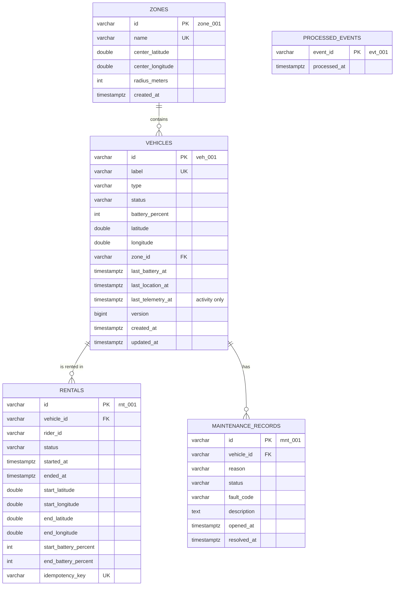

# Fleet Management Service: ER Diagram (v0.2)

## Reading the diagram

- Prefixed identifiers: Entity IDs follow <prefix>_<id> conventions (zone_001, veh_001, rnt_001, mnt_001, evt_001).
- **One zone has many vehicles.** `zone_id` is optional because a vehicle can be outside every zone.
- **One vehicle has many rentals over time**, but only one can be `ACTIVE` at once (partial unique index).
- **One vehicle has many maintenance records over time**, with at most one unresolved record per reason (partial unique index).
- **`PROCESSED_EVENTS` stands alone.** It is internal bookkeeping so Kafka consumers can ignore duplicate events.
- **Battery and location are timed independently.** `last_battery_at` and `last_location_at` decide whether a reading is stale. `last_telemetry_at` only records activity.

## Constraints that are not visible in the diagram

| Constraint | Table | Purpose |
|---|---|---|
| `battery_percent` between 0 and 100 | vehicles | Reject invalid data |
| `status`, `type`, `reason` limited to known values | all | Reject typos |
| One `ACTIVE` rental per vehicle | rentals | Prevent double rentals |
| One `ACTIVE` rental per rider | rentals | Business rule BR-02 |
| One unresolved record per vehicle and reason | maintenance_records | Make duplicate telemetry harmless |
| `ended_at` set if and only if `COMPLETED` | rentals | Keep data consistent |
| IDs match `^<prefix>_[A-Za-z0-9_-]+$` (`zone_`, `veh_`, `rnt_`, `mnt_`, `evt_`) | all | Reject raw UUIDs and typos |
