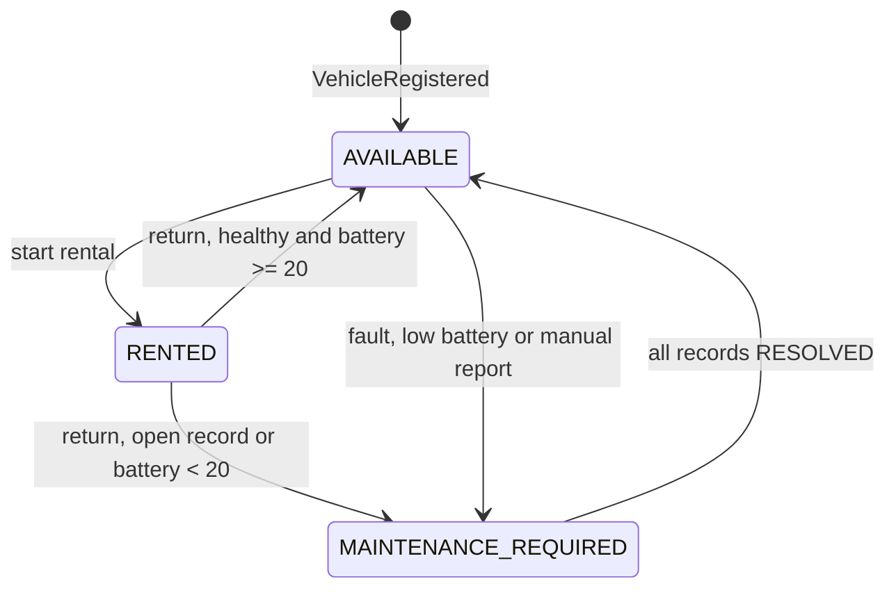
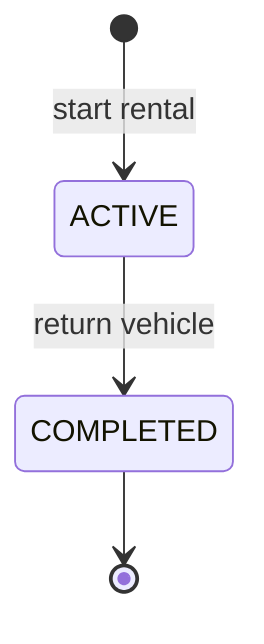
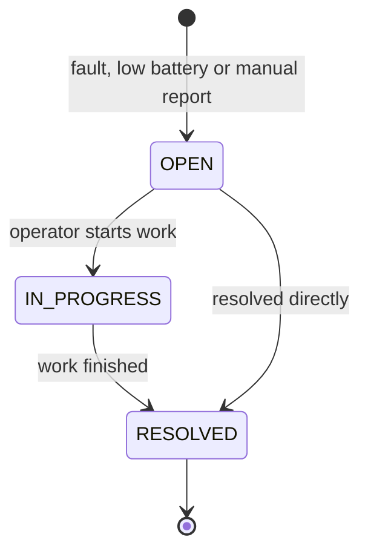

# Fleet Management Service: Domain Model 
This document defines what the `fleet-management-service` stores, which rules it enforces, and why
---

## 1. Design decisions and reasons
| D1 | All IDs are **UUIDs** (strings in JSON). | The plan requires "stable IDs in cross-service data". UUIDs can be created by any service, so Kafka messages and the simulator never wait for a database. | Auto-increment integers: they leak database internals and clash between services. |
| D2 | Vehicle `status` has only **3 values**: `AVAILABLE`, `RENTED`, `MAINTENANCE_REQUIRED`. | Fewer states means fewer bugs and a simpler state machine for students to reason about. | More states (`RESERVED`, `CHARGING`, `RETIRED`...): useful in production but not needed for the acceptance criteria. |
| D3 | "Rentable" is **derived**, not stored: `status = AVAILABLE` and `battery >= 20`. The API returns it as a read-only `rentable` field. | Battery changes constantly. Storing a duplicate flag would go stale. | A `LOW_BATTERY` status: it would mix two independent facts (is it rented? is the battery low?). |
| D4 | Low battery (under 20%) on a vehicle that is not rented **automatically opens a `LOW_BATTERY` maintenance record** and sets the vehicle to `MAINTENANCE_REQUIRED`. | This gives the AI planner and operators a clear "needs charging" list, and the vehicle can never be rented with a nearly empty battery. | Leaving low-battery vehicles `AVAILABLE`: rental logic gets messy and the "maintenance-required vehicles" API would miss them. |
| D5 | Maintenance is its **own entity** (`maintenance_records`), not just a flag on the vehicle. | A vehicle can have a history of faults. We need reason, timestamps and notes for audit. The `VehicleMaintenanceChanged` event needs a stable ID. | A boolean `needs_maintenance` column: loses the history and the reason. |
| D6 | A **rented vehicle stays `RENTED`** even if it faults or its battery drops. The change takes effect when it is returned. | We must never strand a rider mid-trip because of a status change. | Instantly forcing maintenance: breaks the rental flow. |
| D7 | Locations are plain `latitude` / `longitude` doubles. "Nearby" uses a **bounding box plus Haversine formula** in SQL. No PostGIS. | PostGIS adds an extension, a special Docker image and new concepts. For about 12 to 100 vehicles, plain math is fast enough and easy to explain. | PostGIS: the right choice for production, but too heavy for a student demonstrator. |
| D8 | **Zones are circles** (center + radius). The service assigns `zone_id` from the vehicle's location and stores it. | Needed for "availability by area" and rebalancing between areas. A circle is trivial to compute and to draw on a map. | Polygons: harder to store, validate and draw. |
| D9 | The rider is just a **`riderId` string**. There is no rider table. | Authentication is out of scope. A string identifies the rider well enough for the demo. | A riders table with accounts: scope creep. |
| D10 | **Start-rental uses an `Idempotency-Key` header** (stored in a unique column). **Return-rental and approve/reject are naturally idempotent** (same request twice gives the same result). | The plan requires idempotent rentals and proposals. Mobile apps retry on bad networks, so a duplicate "start" must not create two rentals. | Requiring keys everywhere: unnecessary when the current state already makes the repeat harmless. |
| D11 | **Database constraints are the last line of defense**: partial unique indexes allow only one `ACTIVE` rental per vehicle and per rider; a `version` column supports optimistic locking. | Two riders tapping "rent" at the same moment must not both succeed. Application code can have race conditions; the database cannot. | Only checking in Java code: fails under concurrency (the Week 4 requirement). |
| D12 | Telemetry reaches the service **only through Kafka**, never a REST endpoint. Duplicates are ignored using a `processed_events` table, and **stale events** (measured earlier than the last stored telemetry) are ignored. | Matches the rule "services communicate only via documented REST or Kafka" and "consumers tolerate duplicate delivery". | A REST telemetry endpoint: bypasses the event design. |
| D13 | **O# Fleet Management Service: Domain Model

## 1. Scope

`fleet-management-service` **owns**:
- Vehicles and operational status
- Zones
- Rentals
- Maintenance records

---

## 2. Entities

### 2.1 Zone

| Field | Type | Rules |
|---|---|---|
| `id` | UUID | Primary key |
| `name` | text, unique | e.g. "Campus" |
| `centerLatitude` / `centerLongitude` | decimal degrees | -90..90 and -180..180 |
| `radiusMeters` | integer | greater than 0 |
| `createdAt` | UTC timestamp | |

### 2.2 Vehicle

| Field | Type | Rules |
|---|---|---|
| `id` | UUID | Primary key |
| `label` | text, unique | Human-readable code |
| `type` | enum | `E_BIKE` or `E_SCOOTER` |
| `status` | enum | `AVAILABLE`, `RENTED`, `MAINTENANCE_REQUIRED` |
| `batteryPercent` | integer | 0..100 |
| `latitude` / `longitude` | decimal degrees | Updated by telemetry |
| `zoneId` | UUID or null | FK to Zone |
| `lastTelemetryAt` | UTC timestamp or null | Timestamp of last telemetry |
| `rentable` | boolean | Derived (`status = AVAILABLE` and `batteryPercent >= 20`) |
| `version` | integer | Database versioning |
| `createdAt` / `updatedAt` | UTC timestamps | |

### 2.3 Rental

| Field | Type | Rules |
|---|---|---|
| `id` | UUID | Primary key |
| `vehicleId` | UUID | FK to Vehicle |
| `riderId` | text | Rider identifier |
| `status` | enum | `ACTIVE` or `COMPLETED` |
| `startedAt` / `endedAt` | UTC timestamps | `endedAt` is null while `ACTIVE` |
| `startLatitude` / `startLongitude` | decimal | Copied from vehicle at start |
| `endLatitude` / `endLongitude` | decimal or null | Supplied on return |
| `startBatteryPercent` / `endBatteryPercent` | integer | Snapshot values |
| `idempotencyKey` | text, unique | From `Idempotency-Key` header |

### 2.4 MaintenanceRecord

| Field | Type | Rules |
|---|---|---|
| `id` | UUID | Primary key |
| `vehicleId` | UUID | FK to Vehicle |
| `reason` | enum | `LOW_BATTERY`, `FAULT`, `MANUAL` |
| `status` | enum | `OPEN`, `IN_PROGRESS`, `RESOLVED` |
| `faultCode` | text or null | Mandatory for `FAULT` |
| `description` | text or null | Free text |
| `openedAt` / `resolvedAt` | UTC timestamps | `resolvedAt` set when `RESOLVED` |

### 2.5 ProcessedEvent (internal)

| Field | Type | Rules |
|---|---|---|
| `eventId` | UUID | Primary key |
| `processedAt` | UTC timestamp | Processing timestamp |

---

## 3. State Machines

### 3.1 Vehicle Status

### 3.2 Rental Status

### 3.3 Maintenance Status

---

## 4. Business Rules

| ID | Rule |
|---|---|
| BR-01 | A rental can start only if the vehicle is `AVAILABLE` and `batteryPercent >= 20`. |
| BR-02 | A rider can have only one `ACTIVE` rental. |
| BR-03 | Starting a rental sets vehicle status to `RENTED`, records location/battery, and publishes `RentalStarted`. |
| BR-04 | Re-submitting a start request with the same `Idempotency-Key`, vehicle, and rider returns the existing rental (`200`). Reusing a key with different parameters returns `409 IDEMPOTENCY_KEY_REUSED`. |
| BR-05 | Returning a rental updates status to `COMPLETED`, records end location/battery, and publishes `RentalEnded`. |
| BR-06 | Returning an already `COMPLETED` rental returns `200` without publishing duplicate events. |
| BR-07 | Upon return, a vehicle transfers to `MAINTENANCE_REQUIRED` if unresolved maintenance exists or battery is < 20. Otherwise, status becomes `AVAILABLE`. |
| BR-08 | Telemetry reporting battery < 20 on an unrented vehicle opens a `LOW_BATTERY` record and sets status to `MAINTENANCE_REQUIRED`. On a rented vehicle, the record is opened immediately, but status transition occurs upon rental return. |
| BR-09 | `VehicleFaultReported` events create a single unresolved `FAULT` record per vehicle. |
| BR-10 | A vehicle transitions from `MAINTENANCE_REQUIRED` to `AVAILABLE` when all unresolved records are marked `RESOLVED`. `LOW_BATTERY` records resolve automatically when battery reaches >= 50. |
| BR-11 | Any change in maintenance state publishes `VehicleMaintenanceChanged`. |
| BR-12 | Telemetry events with `measuredAt` older than `lastTelemetryAt` or with IDs present in `processed_events` are ignored. |
| BR-13 | Fleet state changes resulting from rebalancing occur only upon consumption of `RebalancingProposalApproved` events. |

---

## 5. System Parameters

| Name | Value | Purpose |
|---|---|---|
| `MIN_RENTABLE_BATTERY_PERCENT` | 20 | Minimum battery threshold for rental |
| `LOW_BATTERY_RESOLVE_PERCENT` | 50 | Auto-resolution threshold for low battery records |
| `NEARBY_DEFAULT_RADIUS_METERS` | 1000 | Default radius for geographic queries |
| `NEARBY_MAX_RADIUS_METERS` | 5000 | Maximum radius limit for geographic queries |
| `LIST_DEFAULT_LIMIT` | 100 | Default query limit |
| `LIST_MAX_LIMIT` | 500 | Maximum query limit |
| `SSE_HEARTBEAT_SECONDS` | 15 | Interval for SSE heartbeat |

---

## 6. Error Codes

| HTTP Status | `code` |
|---|---|
| 400 | `VALIDATION_ERROR` |
| 400 | `MISSING_IDEMPOTENCY_KEY` |
| 404 | `NOT_FOUND` |
| 409 | `VEHICLE_NOT_AVAILABLE` |
| 409 | `BATTERY_TOO_LOW` |
| 409 | `RIDER_HAS_ACTIVE_RENTAL` |
| 409 | `IDEMPOTENCY_KEY_REUSED` |
| 409 | `DUPLICATE_VEHICLE_LABEL` |
| 409 | `INVALID_STATUS_TRANSITION` |
| 409 | `PROPOSAL_ALREADY_DECIDED` |
| 500 | `INTERNAL_ERROR` |

ne error format**, and **HTTP 409 for every business-rule conflict** (vehicle not available, battery too low, rider already renting...). The specific reason is in the `code` field. | Mobile and dashboard developers handle one shape and one status class. The `code` gives the detail. | Mixing 409 and 422: two ways to handle one kind of problem. |
| D14 | **Proposals and planner runs are owned by `ai-planner`** (Person 5). They appear in this API contract for convenience, with their own server URL. The fleet service **consumes** `RebalancingProposalApproved` events to apply operational changes. | Section 4.1 says the planner stores proposals, and Person 5 builds "proposal persistence" in Week 2. Human approval then drives fleet state through an auditable event. | Fleet service storing proposals: would contradict the service ownership map. **Needs Person 5's confirmation (see open questions).** |
| D15 | Live updates use **SSE** (one-way server push) with three event types: `vehicle.updated`, `fleet.status`, `heartbeat`. | SSE is simpler than WebSockets and is what the plan specifies. | WebSockets: two-way channel we do not need. |
| D16 | List endpoints return **plain arrays with a `limit` parameter** (default 100). No pagination wrapper. | The demo fleet is small. Simple responses are easier for the mobile and dashboard teams. | Cursor pagination: over-engineering for the project size. |
| D17 | Status and type columns are **`VARCHAR` with `CHECK` constraints**, not PostgreSQL `ENUM` types. | Easier to change in migrations and works smoothly with JPA/Hibernate. | PostgreSQL enums: painful to alter. |
| D18 | **No vehicle delete endpoint.** | Rentals and maintenance history reference vehicles, so deleting would break the audit trail. CRUD in the Week 2 plan is covered by create, read and update. A retire/decommission feature can be added later. | Hard delete: breaks history. |
| D19 | **No outbox table** in v0.1. Events are published right after the database commit. | Keeps Week 1 and Week 2 simple. It is listed as a known limitation (section 9). | Transactional outbox pattern: correct, but extra moving parts. |

---

## 3. Entities

### 3.1 Zone

| Field | Type | Rules |
|---|---|---|
| `id` | UUID | Primary key |
| `name` | text, unique | e.g. "Campus" |
| `centerLatitude` / `centerLongitude` | decimal degrees | -90..90 and -180..180 |
| `radiusMeters` | integer | greater than 0 |
| `createdAt` | UTC timestamp | |

### 3.2 Vehicle

| Field | Type | Rules |
|---|---|---|
| `id` | UUID | Primary key |
| `label` | text, unique | Human-readable code painted on the vehicle, e.g. `EB-001` |
| `type` | enum | `E_BIKE` or `E_SCOOTER` |
| `status` | enum | `AVAILABLE`, `RENTED`, `MAINTENANCE_REQUIRED` |
| `batteryPercent` | integer | 0..100 |
| `latitude` / `longitude` | decimal degrees | Updated by telemetry events |
| `zoneId` | UUID or null | Derived from location (nearest zone containing the point) |
| `lastTelemetryAt` | UTC timestamp or null | Used to ignore stale events |
| `rentable` | boolean (**derived**, API only) | `status = AVAILABLE` and `batteryPercent >= 20` |
| `version` | integer (database only) | Optimistic locking |
| `createdAt` / `updatedAt` | UTC timestamps | |

### 3.3 Rental

| Field | Type | Rules |
|---|---|---|
| `id` | UUID | Primary key |
| `vehicleId` | UUID | Foreign key to vehicle |
| `riderId` | text | Free-text rider identifier (no accounts) |
| `status` | enum | `ACTIVE` or `COMPLETED` |
| `startedAt` / `endedAt` | UTC timestamps | `endedAt` is empty while `ACTIVE` |
| `startLatitude` / `startLongitude` | decimal | Copied from the vehicle at start |
| `endLatitude` / `endLongitude` | decimal or null | Supplied by the rider's app on return |
| `startBatteryPercent` / `endBatteryPercent` | integer | Snapshot values for history and analytics |
| `idempotencyKey` | text, unique | From the `Idempotency-Key` header |

### 3.4 MaintenanceRecord

| Field | Type | Rules |
|---|---|---|
| `id` | UUID | Primary key |
| `vehicleId` | UUID | Foreign key to vehicle |
| `reason` | enum | `LOW_BATTERY`, `FAULT`, `MANUAL` |
| `status` | enum | `OPEN`, `IN_PROGRESS`, `RESOLVED` |
| `faultCode` | text or null | Only for `FAULT`, e.g. `BRAKE_SENSOR` |
| `description` | text or null | Free text |
| `openedAt` / `resolvedAt` | UTC timestamps | `resolvedAt` set only when `RESOLVED` |

At most **one unresolved record per vehicle per reason**. This makes duplicate telemetry events harmless.

### 3.5 ProcessedEvent (internal)

Stores the IDs of Kafka events already handled, so a duplicate delivery is ignored. Not exposed through the API.

---

## 4. State machines

### 4.1 Vehicle status

### 4.2 Rental status

### 4.3 Maintenance status

---

## 5. Business rules

| ID | Rule |
|---|---|
| BR-01 | A rental can start only if the vehicle is `AVAILABLE` **and** `batteryPercent >= 20`. Otherwise `409 VEHICLE_NOT_AVAILABLE` or `409 BATTERY_TOO_LOW`. |
| BR-02 | A rider can have only one `ACTIVE` rental. Otherwise `409 RIDER_HAS_ACTIVE_RENTAL`. |
| BR-03 | Starting a rental sets the vehicle to `RENTED`, copies its location and battery into the rental, and publishes `RentalStarted`. |
| BR-04 | Repeating **start** with the same `Idempotency-Key` and the same vehicle and rider returns the original rental (`200`). Reusing a key with a different vehicle or rider gives `409 IDEMPOTENCY_KEY_REUSED`. |
| BR-05 | Returning a rental sets it `COMPLETED`, stores the end location and battery, and publishes `RentalEnded`. |
| BR-06 | Returning an already `COMPLETED` rental returns it unchanged (`200`) and publishes **no** second event. |
| BR-07 | After a return, the vehicle becomes `MAINTENANCE_REQUIRED` if it has an unresolved maintenance record or its battery is under 20 (a `LOW_BATTERY` record is opened). Otherwise it becomes `AVAILABLE`. |
| BR-08 | A telemetry battery reading under 20 on a vehicle that is **not** rented opens a `LOW_BATTERY` record (once) and sets `MAINTENANCE_REQUIRED`. On a rented vehicle, the record is created but the status change waits for the return (decision D6). |
| BR-09 | A `VehicleFaultReported` event opens a `FAULT` record (once per vehicle while unresolved). |
| BR-10 | When the last unresolved record of a `MAINTENANCE_REQUIRED` vehicle is resolved, the vehicle becomes `AVAILABLE`. A `LOW_BATTERY` record is also resolved automatically when telemetry reports battery of 50 or more. |
| BR-11 | Every maintenance change publishes `VehicleMaintenanceChanged`. |
| BR-12 | Telemetry events with a `measuredAt` older than the vehicle's `lastTelemetryAt` are ignored. Events whose ID is already in `processed_events` are ignored. |
| BR-13 | The planner never changes vehicle state. Only an operator-approved proposal (event `RebalancingProposalApproved`) can lead the fleet service to change state, and the change is logged. |

---

## 6. Configuration constants

| Name | Value | Purpose |
|---|---|---|
| `MIN_RENTABLE_BATTERY_PERCENT` | 20 | Below this, a vehicle cannot be rented (BR-01, BR-07, BR-08) |
| `LOW_BATTERY_RESOLVE_PERCENT` | 50 | Auto-resolve a `LOW_BATTERY` record at or above this (BR-10) |
| `NEARBY_DEFAULT_RADIUS_METERS` | 1000 | Default search radius |
| `NEARBY_MAX_RADIUS_METERS` | 5000 | Upper limit for search radius |
| `LIST_DEFAULT_LIMIT` / `LIST_MAX_LIMIT` | 100 / 500 | List endpoint size |
| `SSE_HEARTBEAT_SECONDS` | 15 | Keeps connections alive |

Put these in `application.yml` so they can be changed without code edits.

---

## 7. Error codes

All errors use this JSON shape: `{ code, message, timestamp, correlationId, details }`.

| HTTP | `code` | When |
|---|---|---|
| 400 | `VALIDATION_ERROR` | Malformed or out-of-range input |
| 400 | `MISSING_IDEMPOTENCY_KEY` | `POST /rentals` without the header |
| 404 | `NOT_FOUND` | Unknown vehicle, rental, maintenance record, proposal or run |
| 409 | `VEHICLE_NOT_AVAILABLE` | Vehicle is rented or in maintenance |
| 409 | `BATTERY_TOO_LOW` | Battery below the rentable minimum |
| 409 | `RIDER_HAS_ACTIVE_RENTAL` | Rider already has an active rental |
| 409 | `IDEMPOTENCY_KEY_REUSED` | Same key, different request |
| 409 | `DUPLICATE_VEHICLE_LABEL` | Label already exists |
| 409 | `INVALID_STATUS_TRANSITION` | e.g. reopening a resolved maintenance record |
| 409 | `PROPOSAL_ALREADY_DECIDED` | Approving a rejected proposal (or the reverse) |
| 500 | `INTERNAL_ERROR` | Unexpected failure |

---

## 8. Concurrency and idempotency summary

| Operation | Protection |
|---|---|
| Start rental | `Idempotency-Key` unique column and a partial unique index (one `ACTIVE` rental per vehicle and per rider). If two requests race, the loser gets `409`. |
| Return rental | State check (`COMPLETED` returns unchanged) |
| Vehicle update from telemetry | Optimistic `version` column plus stale-event check |
| Kafka consumers | `processed_events` table |
| Approve / reject proposal | State check in `ai-planner` (same pattern) |

---

## 9. Known limitations (accepted for v0.1)

- No authentication or authorization (out of scope; Week 5 adds only basic validation boundaries).
- No transactional outbox: a crash between database commit and Kafka publish could lose an event (D19).
- No pricing, payments or rider accounts.
- Zones are circles and may overlap; the nearest center wins.
- No vehicle retirement or delete (D18).

---

## 10. Open questions for the team

| # | Question | For |
|---|---|---|
| Q1 | Confirm that `ai-planner` stores proposals and exposes approve/reject, and that the fleet service reacts to `RebalancingProposalApproved` (D14). | Person 5 |
| Q2 | Who publishes `DemandRecorded`? Proposal: the simulator publishes it. Alternatively the MCP read model derives demand from `RentalStarted`. | Persons 2 and 5 |
| Q3 | Confirm the telemetry event payload fields listed in `events-owned.md` (section 3). | Person 2 |
| Q4 | Is `GET /vehicles/nearby` enough for the mobile "discover" screen, or does it need extra filters (vehicle type)? | Person 4 |
| Q5 | Does the dashboard need extra SSE event types (for example maintenance updates)? | Person 3 |
| Q6 | Port numbers: fleet 8080, telemetry 8081, ai-planner 8082, mcp 8083. OK for everyone? | All |
